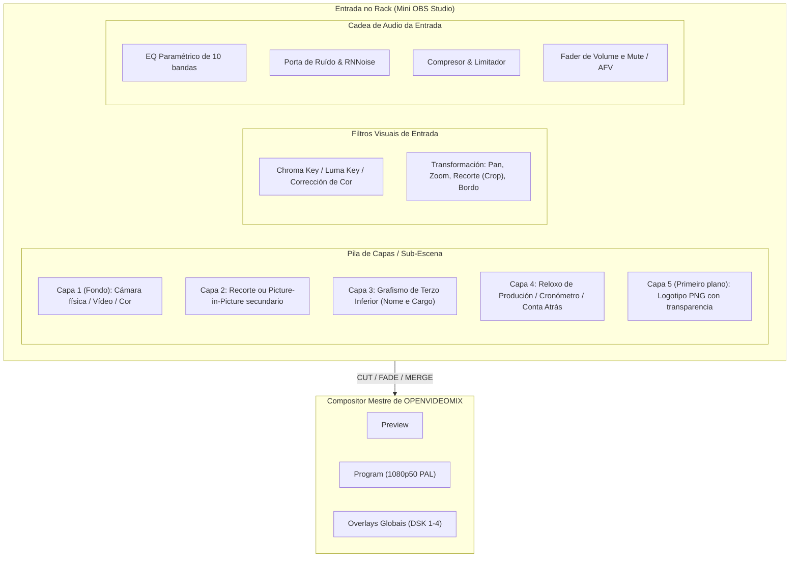

# INPUT ARCHITECTURE: EVERY INPUT AS A "MINI OBS STUDIO"

> **Milestone:** Issue #72 (`feat(scene): Nested Input Compositor`)  
> **Status:** Architectural Specification  
> **Target System:** OPENVIDEOMIX  

---

## 1. O Paradigma de Entrada Enriquecida / Enriched Input Paradigm

No software de realización tradicional (como vMix básico), un *Input* adoita ser un fluxo plano único (unha cámara ou un vídeo). En OBS Studio, polo contrario, existen *Escenas* que conteñen múltiples fontes, pero a xestión de conmutación directa é máis ríxida.

En **OPENVIDEOMIX**, unificamos ambos mundos: **cada Entrada no rack é un pequeno estudo completo (un «mini OBS Studio»)**.

Isto significa que calquera entrada non só reproduce a súa fonte principal, senón que pode levar empaquetadas, sincronizadas e integradas as súas propias capas, grafismos, efectos e procesamento de son:



---

## 2. Capacidades de Cada Entrada / Per-Input Capabilities

### 2.1. Pila de Capas Visuais (Sub-Escena Multi-Capa)
Cada entrada contén a súa propia lista ordenada de capas con orde Z (*z-index*):
- **Capa Base:** Cámara física (USB/HDMI/SDI), fluxo de rede (SRT/NDI), ficheiro de vídeo con bucle, pase de diapositivas ou cor lisa.
- **Reloxo / Cronómetro Dinámico:**
  - Reloxo dixital en tempo real con axuste de zona horaria.
  - Cronómetro de produción / conta atrás (countdown) cara a cero con cambio de cor cando quedan menos de 30 segundos.
- **Grafismo de Terzo Inferior (*Lower Third*):**
  - Caixa de rótulo para nome, cargo, subtítulo ou logotipo do relator.
  - Actualizable en directo sen cortar a imaxe.
- **Logotipos e Superposicións PNG:**
  - Marcas de auga, logotipos con canal alfa ou marcos deseñados a medida.
- **Transformacións por Capa:**
  - Posición $(X, Y)$, escala/zoom, recorte rectangular (*Crop* $X_1, X_2, Y_1, Y_2$), bordo de cor e redondeo de esquinas (*border radius*).

### 2.2. Filtros e Procesamento da Entrada
- **Chroma Key e Luma Key Integrado:** A propia entrada pode eliminar o fondo verde da cámara antes de compoñer as súas capas internas.
- **Corrección de Cor:** Lift, Gamma, Gain e Saturación independentes por entrada.

### 2.3. Audio e Automatización AFV
- O son da entrada ten a súa propia ganancia, atraso de sincronización (*delay* en ms), ecualizador e compresor.
- **AFV (Audio Follows Video):** Cando a entrada pasa a Program, o seu son ábrese suavemente; cando sae de Program, silénciase para evitar micros abertos non desexados.

---

## 3. Estrutura de Datos en Rust (`crates/core`)

```rust
#[derive(Debug, Clone, Serialize, Deserialize)]
pub struct StudioInput {
    pub id: InputId,
    pub name: String,
    pub main_source: MediaSourceKind,
    pub layers: Vec<InputLayer>,
    pub visual_filters: VisualFilters,
    pub audio_dsp: AudioDspSettings,
    pub afv_enabled: bool,
}

#[derive(Debug, Clone, Serialize, Deserialize)]
pub enum InputLayerKind {
    SecondaryVideo(InputId),
    ProductionClock { format_24h: bool, show_seconds: bool },
    CountdownTimer { duration_secs: u64, auto_start: bool },
    LowerThird { headline: String, description: String, template_id: String },
    StaticGraphic { path: PathBuf, opacity: f32 },
}

#[derive(Debug, Clone, Serialize, Deserialize)]
pub struct InputLayer {
    pub id: Uuid,
    pub kind: InputLayerKind,
    pub transform: LayerTransform,
    pub is_visible: bool,
}
```

---

## 4. Vantaxes Operativas
1. **Un só clic no aire:** O realizador preme sobre a entrada e todo o paquete gráfico (persoa, o seu rótulo, o seu reloxo e o logo) sae coordinado e encadrado sen ter que activar 4 botóns á vez.
2. **Reutilización:** Unha entrada pódese clonar como entrada virtual mantendo os axustes pero cambiando o participante.
3. **Alto Rendemento:** A sub-composición resólvese nun só paso de shader GPU (`wgpu`), sen gastar ciclos de CPU nin xerar atraso no reloxo de 50 FPS.
