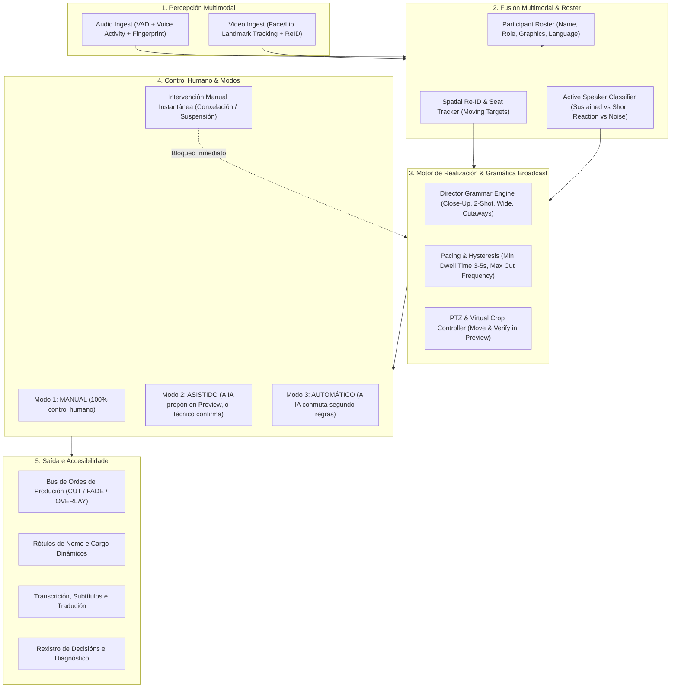

# MULTIMODAL AI AUTO-DIRECTOR & PARTICIPANT IDENTIFICATION SPECIFICATION

> **Status:** Architecture & Functional Specification (Target Milestone: P1 / #47)  
> **Document Reference:** `docs/MULTIMODAL_AUTO_DIRECTOR_SPEC.md`  
> **Target System:** OPENVIDEOMIX Live Broadcast Production  

---

## 1. Visión e Obxectivo Xeral / Executive Overview

OPENVIDEOMIX incorpora un sistema de **intelixencia artificial local para a realización automática e a identificación de participantes en tempo real**. O sistema identifica quen está no plató, segue a súa posición cando se move polo escenario, detecta con precisión quen está a falar de xeito sostido e selecciona os planos e composicións axeitados segundo a gramática televisiva definida polo realizador.

O sistema non substitúe o criterio humano: deseñouse como unha ferramenta supervisable con tres modos operativos e toma de control manual inmediata e incondicional.

---

## 2. Alicerces do Sistema / Functional Pillars



---

## 3. Especificación Técnica Polo Miúdo / Detailed Technical Specification

### 3.1. Identificación dos Participantes (Roster & Profile)
- **Ficha de Participante (`ParticipantProfile`):**
  - `id`: Identificador único UUID.
  - `name`: Nome completo para visualización e rexistro.
  - `role`: Rol no programa (`Host` / Presentador, `Guest` / Convidado, `Collaborator` / Colaborador, `Audience` / Público).
  - `graphic_template`: Modelo de rótulo (terzo inferior / *lower third*) asociado con nome, cargo e estilo.
  - `language`: Código de idioma preferente (ex.: `gl`, `es`, `en`).
  - `audio_channel`: Entrada/canle de micrófono físico asociada.
  - `biometric_calibration` (opcional):
    - Pegada vocal / características acústicas (recollidas en lectura neutra previa de calibración de 20s).
    - Embedding facial de referencia para re-identificación.
- **Asignación:** Pode realizarse mediante calibración automática previa ou de xeito 100% manual polo operador.

### 3.2. Seguimento de Posicións Variables (Spatial Tracking & Re-ID)
- As persoas poden cambiar de asento, erguerse ou desprazarse polo escenario.
- O subsistema de visión por computador mantén un mapa espacial de coordenadas e unha cola de rastrexo (*tracking thread*) con modelos de re-identificación visual (ReID).
- **Control de Incerteza:**
  - Puntuación de confianza $C \in [0.0, 1.0]$.
  - Se a confianza cae por baixo do limiar de seguridade ($C < C_{\text{threshold}}$, p. ex. 0.70), o sistema **nunca inventa nin atribúe unha identidade dubidosa**: non mostra rótulos incorrectos e mantén a fonte como non identificada.

### 3.3. Detección Multimodal de Quen Fala (Active Speaker Detection)
- A decisión non depende unicamente do volume do micrófono (evitando que un golpe na mesa, tose ou eco active o plano).
- **Fusión Sensorial:**
  1. **Visual:** Actividade e apertura labial / movemento de beizos (*Lip Motion Index*).
  2. **Acústico:** Detección de actividade vocal (VAD) + concordancia con pegada de voz calibrada.
- **Clasificación de Intervencións:**
  - *Intervención Sostida*: Fala continuada durante máis de 600–800 ms $\rightarrow$ activa a gramática de primeiro plano.
  - *Reacción Breve*: Respostas curtas ("si", "claro", risas breves) $\rightarrow$ non provocan un corte brusco; pódese manter o plano actual ou mostrar un plano conxunto.
  - *Fala Simultánea / Debate Cruzado*: Dúas ou máis persoas falan ao mesmo tempo $\rightarrow$ paso automático a plano conxunto ou plano xeral de debate.

### 3.4. Gramática de Realización Broadcast e Ritmo (Director Engine)
- **Gramática de Planos:**
  - **Primeiro Plano (Close-Up):** Conmutación á cámara ou recorte da persoa que ten a palabra.
  - **Plano Conxunto (Two-Shot / Group):** Activado durante diálogo rápido entre dúas persoas ou debate fluído.
  - **Plano Xeral (Wide Shot):** Activado cando falan varios participantes á vez, cando hai momentos de transición ou cando a confianza visual/acústica é baixa.
  - **Planos de Recurso (Cutaways):** Planos da mesa, do público ou do presentador escoitando, intercalados segundo a cadencia do programa.
- **Protección Anti-Oscilación (Pacing & Hysteresis):**
  - **Tempo Mínimo de Permanencia (*Minimum Dwell Time*):** Ningún plano automático pode durar menos de $3.0$ segundos (configurable entre 2s e 8s), evitando cortes frenéticos ou mareantes.
  - **Límites de Frecuencia de Corte:** Limitador de número máximo de cortes por minuto.
  - **Atraso de Decisión Orientativo:** $\le 500$ ms desde a confirmación da intervención sostida ata o disparo da orde.

### 3.5. Encadramento Intelixente, Recortes Virtuais e Cámaras PTZ
- **Fontes de Alta Resolución (4K/8K):** Xeración de recortes dixitais dinámicos (*virtual camera crops*) con seguimento suave de encadramento (enquadre áurea, regra dos terzos).
- **Control de Cámaras PTZ:**
  - Para cámaras robotizadas con protocolo IP (VISCA sobre IP, ONVIF, NDI PTZ), a IA pode solicitar movementos de reposicionamento cara ao participante.
  - **Regra de Ouro Broadcast:** Cando a cámara PTZ se move, **compróbase primeiro en PREVIEW que o movemento rematou e o plano está estabilizado ANTES de conmutalo a PROGRAM**. Nunca se conmuta unha cámara mentres estea a facer un desprazamento brusco (*pan/tilt/zoom in-flight*), a non ser que o realizador o solicite expresamente.

### 3.6. Idiomas, Grafismo Dinámico e Accesibilidade
- A identificación do participante activa automaticamente o lanzamento do seu rótulo (*Lower Third*) a través da canle de Overlay correspondente (ex. `OV1`), permanecendo en pantalla durante un tempo configurable (ex. 5 segundos) tras comezar a falar.
- O idioma configurado na ficha do participante permite enrutar a súa voz cara a motores locais de **transcrición de fala a texto (STT)**, xerando subtítulos automáticos en tempo real e tradución opcional, con indicación da latencia de procesamento e ventá de revisión/corrección rápida polo operador.

### 3.7. Supervisión Humana: Os 3 Modos Operativos
1. **Modo 1: MANUAL (Técnico)**
   - O realizador ten o control total desde o teclado, rato, mesa MIDI ou Stream Deck. A IA está en silencio (ou só rexistra telemetría).
2. **Modo 2: ASISTIDO (Copiloto / Recomendación)**
   - A IA selecciona e propón o mellor plano no monitor de **PREVIEW**.
   - O operador humano decide se premer **CUT / TAKE** para pasalo ao aire, ou rexeitalo.
3. **Modo 3: AUTOMÁTICO (Realización Autónoma)**
   - A IA executa as ordes tipadas no bus de realización (`ProductionCommand`) segundo as regras de gramática e permanencia configuradas.
- **Intervención Manual Incondicional (Manual Override):**
  - Calquera pulsación de CUT, cambio de entrada a Program, movemento do T-Bar ou orde dende a GUI, MIDI ou OpenDeck **suspende o modo AUTO de xeito inmediato**.
  - O sistema pasa ao estado **AUTO SUSPENDIDO**.
  - **Non existe ningún temporizador de reactivación automática**: a IA non pode volver a cambiar de plano por si mesma tras un *timeout*; só unha pulsación voluntaria e explícita do botón `[REACTIVAR AUTO]` por parte do técnico devolve o control á máquina.
  - O operador pode fixar unha cámara (*Lock Input*), excluír cámaras da realización automática ou bloquear temporalmente os cambios.

### 3.8. Comportamento ante Dúbidas, Fallos e Auditoría
- **Baixa Confianza:** Se as caras están tapadas, as luces fallan, hai eco ou hai ambigüidade, o sistema conxela o plano válido actual ou conmuta ao **Plano Xeral de Seguridade**.
- **Cadencia Inviolable:** A inferencia de IA (redes neuronais de visión e voz) execútase en fíos asíncronos desacoplados; **baixo ningún concepto pode ralentizar o compositor principal de 1080p50 (20 ms por fotograma)**.
- **Privacidade e Custo Cero:** Modelos de inferencia 100% locais (ONNX Runtime / Candle / Vulkan / DirectML / Metal). **Non se envía ningún dato biométrico, vídeo nin son a APIs na nube nin servizos de pagamento**.
- **Caderno de Auditoría (*Decision Log*):** Rexistro de cada decisión tomada con timestamp, puntuación de confianza visual/acústica, razón do corte e incidentes para refinar os parámetros trala emisión.

---

## 4. Estrutura de Datos en Rust (`crates/core`)

```rust
#[derive(Debug, Clone, Serialize, Deserialize)]
pub enum ParticipantRole {
    Host,
    Guest,
    Collaborator,
    Audience,
}

#[derive(Debug, Clone, Serialize, Deserialize)]
pub struct ParticipantProfile {
    pub id: Uuid,
    pub name: String,
    pub role: ParticipantRole,
    pub lower_third_template: String,
    pub title_text: String,
    pub preferred_language: String,
    pub assigned_audio_channel: Option<u32>,
    pub facial_embedding: Option<Vec<f32>>,
    pub voiceprint_embedding: Option<Vec<f32>>,
}

#[derive(Debug, Clone, Copy, PartialEq, Eq, Serialize, Deserialize)]
pub enum AutoDirectorMode {
    Manual,
    Assisted,
    Automatic,
    SuspendedByOperator,
}

#[derive(Debug, Clone, Serialize, Deserialize)]
pub struct DirectorRules {
    pub min_dwell_time_ms: u64,       // e.g. 3500 ms
    pub reaction_cutoff_ms: u64,      // e.g. 800 ms
    pub fallback_wide_input: InputId, // Safe wide shot input
    pub ptz_verify_in_preview: bool,  // Must verify PTZ settle before CUT
    pub min_confidence_threshold: f32,// e.g. 0.70
}
```
