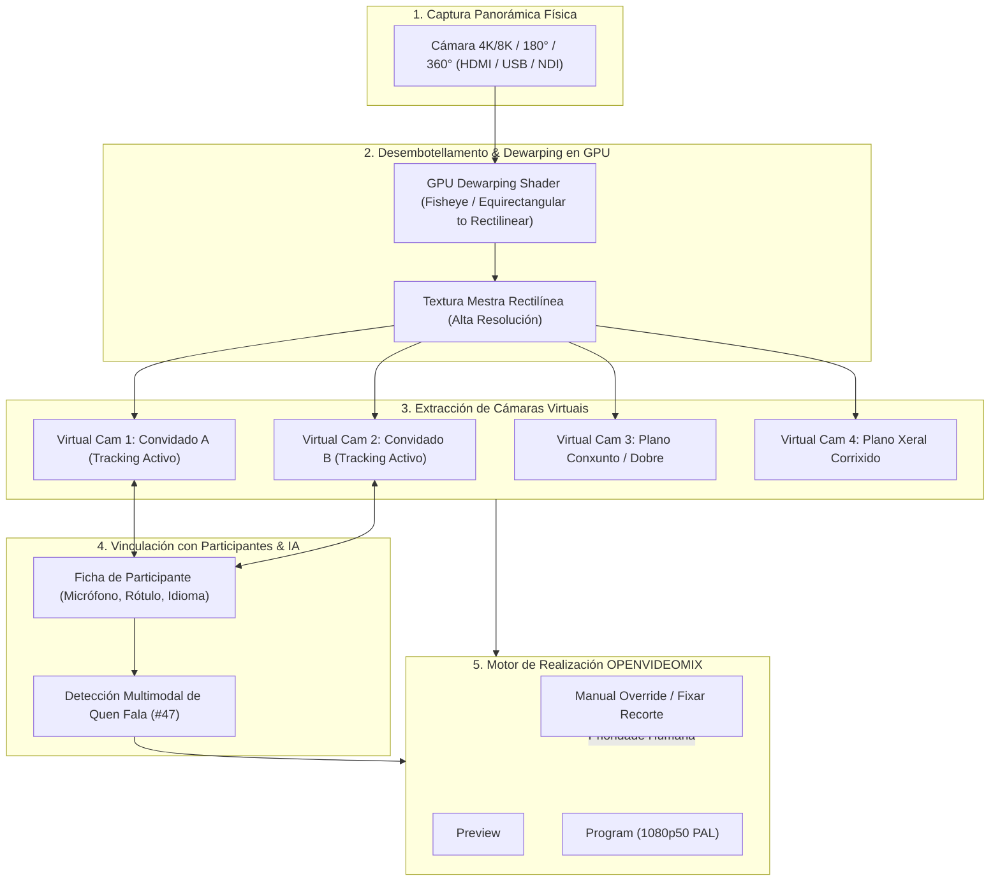

# PANORAMIC VIRTUAL CAMERAS & DYNAMIC RE-FRAMING SPECIFICATION

> **Milestone:** Issue #2 (Virtual cameras and AI-driven auto-framing from ultra-high resolution / 180° / 360° sources)  
> **Status:** Finalized Design & Technical Specification  
> **Target System:** OPENVIDEOMIX  

---

## 1. Visión e Obxectivo do Deseño / Executive Overview

Unha única cámara panorámica de ultra-alta resolución (4K, 6K, 8K ou lentes panorámicas de 180° / 360°) actúa como fonte principal para a cobertura de todo o espazo da emisión. 

OPENVIDEOMIX extrae **múltiples cámaras virtuais independentes** da mesma captura física:
- Planos individuais (primeiros planos) por participante.
- Planos de parellas / planos conxuntos para debates.
- Plano xeral de seguridade coa distorsión de lente corrixida.

Cada recorte constitúe unha **Entrada de vídeo de pleno dereito (`VideoInput`)** no rack de realización de OPENVIDEOMIX, dispoñible tanto para a conmutación manual (GUI, MIDI, Stream Deck) como para a realización automática con IA.



---

## 2. O Fluxo de Traballo en 6 Pasos / 6-Step Operational Flow

1. **Captura Panorámica:** Unha cámara cobre todo o espazo onde se atopan os participantes (mesas de faladoiro, escenario ou plató).
2. **Cámaras Virtuais con Corrección de Distorsión (*Dewarping*):** OPENVIDEOMIX aplica un shader GPU para corrixir a deformación esférica ou de ollo de peixe (*fisheye/equirectangular to rectilinear projection*), xerando planos planos naturais e sen curvaturas nos bordos.
3. **Asociación Persoa–Recorte:** Cada plano individual asóciase á identidade dun participante, ao seu micrófono físico e ao seu correspondente modelo de rótulo.
4. **Seguimento Dinámico (*Smart Re-framing*):** Cando o participante se move polo escenario ou muda de cadeira, o cadro do recorte desprázase e adáptase suavemente (aplicando interpolación *smooth damping* para evitar movementos bruscos). A identidade segue á persoa viva, non a unha posición estática de píxeles na imaxe.
5. **Realización Automática Integrada:** Ao detectar quen fala mediante o subsistema multimodal ([#47](https://github.com/dodemo/OPENVIDEOMIX/issues/47)), o sistema selecciona a cámara virtual desa persoa. En caso de debate cruzado ou intervencións simultáneas, conmuta ao plano de parella ou ao plano xeral corrixido.
6. **Control Manual Pleno:** O realizador técnico pode:
   - Modificar manualmente o zoom e posición de calquera recorte con teclado, rato ou joystick.
   - Fixar un recorte (*Lock Crop*).
   - Conmutar calquera cámara virtual a Preview ou Program manualmente desde a consola ou superficies MIDI/OpenDeck.

---

## 3. Especificación Técnica e Estruturas de Datos

### 3.1. Corrección de Distorsión Panorámica (Dewarping Shader)
- Implementación en **`wgpu` fragment shaders** para executar sobre a GPU en menos de 1 milisegundo por fotograma.
- Parámetros de calibración:
  - Tipo de lente: Rectilínea estándar, Fisheye circular, Fisheye full-frame, Equirectangular 360°, ou Dual Fisheye 180°.
  - Centro óptico $(C_x, C_y)$ e coeficientes de distorsión radial ($k_1, k_2, k_3$).

### 3.2. Modelo de Cámara Virtual (`VirtualCropInput`)
```rust
#[derive(Debug, Clone, Serialize, Deserialize)]
pub struct VirtualCropInput {
    pub input_id: InputId,               // Stable Input ID in Mixer Rack
    pub parent_source_id: InputId,       // Physical 4K/8K Camera Input ID
    pub participant_id: Option<Uuid>,    // Bound participant profile
    pub normalized_rect: NormalizedRect, // (x, y, width, height) in 0.0..1.0
    pub target_rect: NormalizedRect,     // Destination for smooth tracking
    pub smoothing_speed: f32,            // Damping coefficient for reframing
    pub is_locked: bool,                 // Locked by operator (no auto-tracking)
}

#[derive(Debug, Clone, Copy, Serialize, Deserialize)]
pub struct NormalizedRect {
    pub x: f32,      // Top-left X [0.0, 1.0]
    pub y: f32,      // Top-left Y [0.0, 1.0]
    pub width: f32,  // Width [0.0, 1.0]
    pub height: f32, // Height [0.0, 1.0]
}
```

### 3.3. Control de Calidade e Resolución Efectiva
- A resolución final de saída do programa é **1920×1080p50**.
- Cando un recorte se extrae dunha fonte (p. ex., 3840×2160):
  $$\text{Resolución Efectiva} = (\text{width} \times W_{\text{source}}) \times (\text{height} \times H_{\text{source}})$$
- O sistema calcula e mostra un indicador de calidade no inspector da entrada:
  - 🟢 **Óptima:** O recorte contén $\ge 1920 \times 1080$ píxeles nativos (escalado 1:1 ou sub-mostrado de alta definición).
  - 🟡 **Aceptable:** O recorte contén entre $1280 \times 720$ e $1920 \times 1080$ píxeles (upscaling lixeiro mediante interpolación bicúbica na GPU).
  - 🔴 **Baixa Calidade:** O recorte é inferior a $720p$ (aviso ao realizador de que o zoom é excesivo para a resolución do sensor físico).

---

## 4. Criterios de Aceptación (DoD)
- [ ] O módulo de cámaras virtuais compila en Rust sen avisos no workspace.
- [ ] Unha fonte física de vídeo pode xerar múltiples `VideoInput` virtuais concurrentes sen duplicar a decodificación nin a memoria de texturas.
- [ ] O shader de corrección de distorsión procesa a 50.00 FPS con latencia inferior a 2 milisegundos en GPU.
- [ ] O suavizado de seguimento (*smooth damping*) garante movementos fluidos sen saltos de fotograma.
- [ ] O realizador pode tomar o control manual de calquera cámara virtual en calquera instante.
