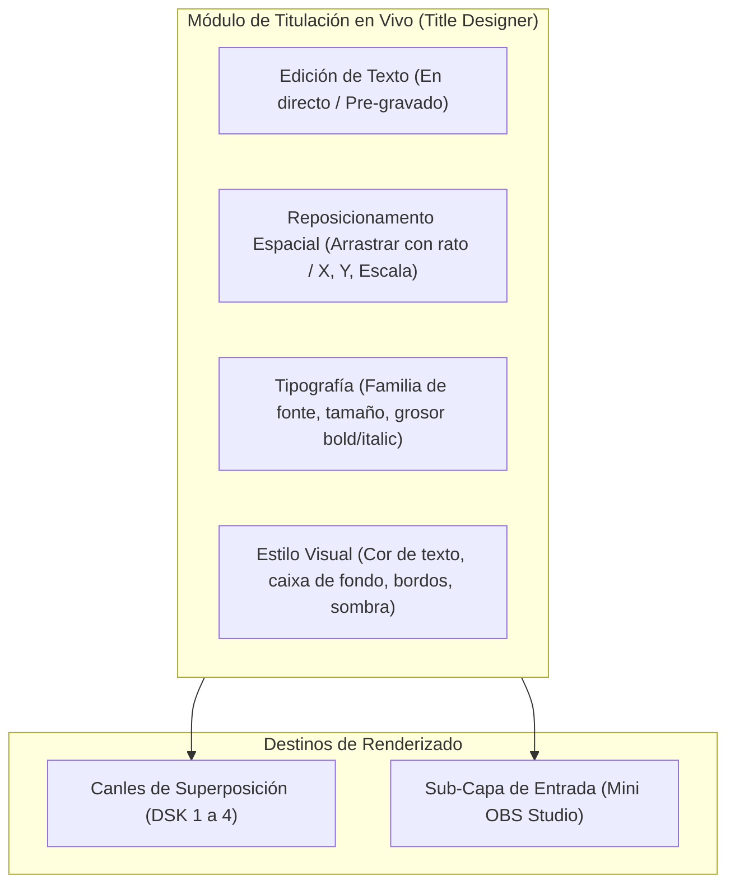

# LIVE TITLE DESIGNER & GRAPHICS STYLING SPECIFICATION

> **Milestone:** Issue #78 (`feat(graphics): Live Title Designer`) & Issue #77 (`feat(ui): Visual Themes & Unicode`)  
> **Status:** Technical Specification  
> **Target System:** OPENVIDEOMIX  

---

## 1. Visión e Obxectivo / Executive Overview

O aspecto visual é fundamental nunha produción televisiva e nunha ferramenta de traballo diario. Esta especificación define dous requisitos esenciais:
1. **Interface de Usuario Adaptable e Tipografía Universal:** Dous temas visuais (Escuro de plató e Claro de oficina), selector de tipografía e soporte estrito de caracteres especiais e acentos en galego/español (ñ, Ñ, á, é, í, ó, ú, ç, ü, ¿, ¡) sen glifos rotos nin erros de renderizado.
2. **Editor e Deseñador de Rótulos en Vivo (*Live Title Designer*):** Un módulo integrado para crear, editar, reposicionar e estilizar grafismos e terzos inferiores (*lower thirds*) para a capa de grafismos e canles de superposición (DSK 1-4).

---

## 2. Soporte Tipográfico e Temas Visuais (Issue #77)

### 2.1. Temas da Interface
- **Tema Escuro (Dark Studio - Predeterminado):**
  - Fondo de paneis en gris carbón neutro (`#121418`) e fiestras en `#181b20`.
  - Bordos de alto contraste con Tally vermello (`#e02424`) para Program e verde (`#22c55e`) para Preview.
  - Deseñado para cabinas de realización e estudios de pouca luz ambiental.
- **Tema Claro (Clean Light):**
  - Fondo claro de alta visibilidade para salas ben iluminadas ou oficinas de produción.
  - Conmutador instantáneo na barra de opcións sen reiniciar o programa.

### 2.2. Soporte Unicode e Tipografías Abertas
- Carga de fontes vectoriais abertas incrustadas no binario (ex. **Inter**, **Fira Sans**, **Ubuntu** ou **Roboto**) que cobren o 100% dos glifos do bloque latino estendido:
  - Vogais acentuadas: `á, é, í, ó, ú, Á, É, Í, Ó, Ú`.
  - Con acento grave ou circunflexo: `à, è, ì, ò, ù, â, ê, ô`.
  - Eñes e cedillas: `ñ, Ñ, ç, Ç`.
  - Diéreses e signos de interrogación/admiración: `ü, Ü, ï, ¿, ¡`.
- Eliminación total de cadradiños de glifo descoñecido (*tofu*) tanto na interface como nos rótulos de emisión.

---

## 3. Deseñador de Rótulos e Terzos Inferiores (Issue #78)

### 3.1. Capacidades de Deseño
- **Reposicionamento Libre:**
  - O operador pode arrastrar o rótulo co rato sobre o monitor de deseño ou axustar coordenadas numéricas ($X, Y$, ancho, alto, rotación e aliñamento esquerda/centro/dereita).
- **Control Tipográfico:**
  - Selección de fonte instalada no sistema ou fontes abertas integradas.
  - Tamaño en puntos, grosor (*Light, Regular, SemiBold, Bold*) e estilo (*Normal, Cursiva*).
- **Estilo e Lexibilidade:**
  - **Cor de Texto:** Selector RGBA e código Hexadecimal.
  - **Caixa de Fondo (*Bounding Box*):** Caixa rectangular personalizable detrás do texto, con cor de recheo, transparencia alfa e esquinas redondeadas (*corner radius*).
  - **Sombra Arroxada (*Drop Shadow*):** Distancia offset en píxeles $(dx, dy)$, desenfoque (*blur radius*) e opacidade da sombra, garantindo que o texto sexa perfectamente lexible sobre calquera fondo de vídeo claro ou escuro.
  - **Liña de Contorno (*Stroke / Outline*):** Bordo exterior para separar o texto do fondo.

### 3.2. Edición en Vivo sen Parar a Emisión
- O realizador pode corrixir unha errata no nome ou cargo dun participante mentres o rótulo está no aire sen ningún parpadeo nin conxelación da cámara.
- Capacidade de gardar modelos (*presets*) en ficheiros `.json` para reutilizar o deseño gráfico en programas sucesivos.
