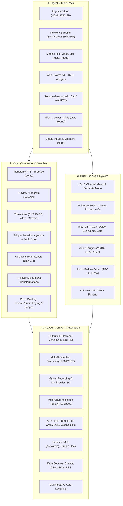
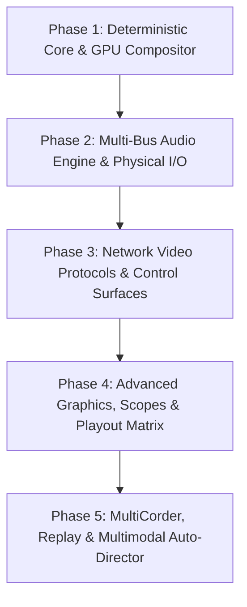

# VMIX OPEN-SOURCE BLUEPRINT: ARCHITECTURAL SPECIFICATION & IMPLEMENTATION PLAN

> **Document Version:** 1.0.0  
> **Target Project:** OPENVIDEOMIX (MIT License)  
> **Source Reference:** vMix Broadcast Production System Specification (236-page manual deconstruct)  
> **Language Standards:** Document technical specifications in standard technical English; conversational interaction in Galego.

---

## 1. Executive Summary & Project Redefinition

**OPENVIDEOMIX** is an open-source (MIT Licensed), cross-platform (Linux, Windows, macOS Intel & Apple Silicon), broadcast-grade live video production system.

### Vision:
To provide a free, modular, and high-performance alternative to proprietary broadcast switchers—principally **vMix**, with secondary workflow references to OBS Studio and NewTek TriCaster. 

While vMix is tied exclusively to Windows, proprietary DirectX/DirectShow pipelines, and legacy .NET technologies (WPF XAML, VB.NET), **OPENVIDEOMIX** rebuilds these broadcast capabilities clean-room using modern **Rust**, portable GPU compute shaders (`wgpu` on Vulkan / Metal / DirectX 12), low-latency audio graphs, and modern open web standards (WebRTC WHIP/WHEP, WebSockets, HTML5/SVG graphics).

### Core Invariants:
1. **Target Broadcast Default:** All new projects, preview, program, compositor pipelines, and outputs default strictly to **1920×1080 progressive at 50.00 FPS (PAL broadcast, 20.0 ms/frame)** with audio at **48 kHz, 32-bit float**. Other standards (25p, 59.94p, 60p, 4K) are explicit configuration options.
2. **Headless Engine Separation:** The mixing engine, GPU compositor, and audio graph run entirely independent of the GUI. GUI repaint frequency never dictates media cadence.
3. **Clean-Room & License Integrity:** 100% clean-room Rust implementation. No binary dumping or reverse engineering of proprietary vMix DLLs; no GPL contamination (OpenDeck host protocol separated via authenticated IPC).
4. **Surface & API Agnostic:** GUI, USB MIDI, Stream Deck / OpenDeck, web remotes, and automated network calls execute the exact same typed commands (`ProductionCommand`) via a central command dispatcher.

---

## 2. Deconstruction of vMix Functional Domains

From the 236-page vMix specification, the software is decomposed into 8 fundamental pillars:



---

## 3. Comprehensive Feature Parity & Enhancement Matrix

| Subsystem | vMix Feature Set (Manual Reference) | OPENVIDEOMIX Approach (Rust Open Source) | Enhancements / Modernizations |
|---|---|---|---|
| **Operating System** | Windows 10/11 x64 only | Cross-platform: Linux (V4L2, PipeWire), Windows (WASAPI, MF), macOS (AVFoundation, CoreAudio) | **First-class Linux & macOS support**; native Docker/headless server capabilities. |
| **Compositing Engine** | DirectX D3D9 / D3D11 (EVR/VMR9) | `wgpu` (Vulkan, Metal, DX12) GPU pipeline with fallback software reference compositor | True vendor-neutral cross-platform shaders; headless testing in CI. |
| **Master Video Clock** | DirectShow clock, Windows multimedia timer | `MediaTimebase` with monotonic nanosecond pacing, strict 50.00 FPS cadence (20ms) | Jitter reporting, drift measurement, zero frame dropping under load. |
| **Inputs: Camera** | DirectShow, Blackmagic DeckLink, Magewell, AJA Kona | GStreamer 1.22+ element pipelines, native Linux V4L2, Windows MediaFoundation, DeckLink SDK | Zero-copy DMABUF/NVMM buffer sharing where hardware supports it. |
| **Inputs: Media Files** | DirectShow, FFMPEG decoder, AVI, MP4, MOV, MKV, QuickTime | GStreamer `uridecodebin` / native FFmpeg decoding; In/Out trim points, seamless looping | Asynchronous pre-buffering, multi-channel audio demuxing. |
| **Inputs: IP Streams** | SRT (Caller/Listener/Rendezvous), NDI, RTSP, UDP TS | Native SRT (`srt-rs`/GStreamer), WebRTC WHIP/WHEP, RTSP, optional NDI wrapper | Modern open streaming protocols prioritized (WHIP/WHEP/SRT) without closed SDK locks. |
| **Inputs: Web Browser** | Chromium Embedded Framework (CEF), Windows 32/64 | Headless Chromium / WPE WebKit via offscreen shared texture buffer | Lower memory footprint, transparent background support, mouse/keyboard IPC forwarding. |
| **Inputs: Remote Call** | "vMix Call" (proprietary WebRTC infrastructure via vmixcall.com) | Standard WebRTC peer-to-peer / WHIP-WHEP room server (self-hostable) | **No proprietary relay dependency**; self-hostable in LAN or on custom cloud TURN/STUN servers. |
| **Inputs: Titles & Graphics** | WPF XAML (deprecated vMix 24) & GT Designer | Vector SVG / HTML5-Canvas & JSON graphics templates (via `resvg` / web view) | Standard open formats; can be designed in Figma, Illustrator, or HTML/CSS. |
| **Inputs: Playlists & Lists** | M3U playlist input with auto-next, shuffle, loop | Typed playlist source with cueing, crossfade between items, M3U import/export | Integrated timing duration calculation and playlist automation triggers. |
| **Switching & Transitions** | CUT, QuickPlay, Fade, Wipe, Slide, Zoom, Fly, Cube, Merge | GPU fragment and vertex shader transitions: Cut, Fade, Wipe, Slide, Zoom, Motion Merge | Deterministic frame interpolation (0–255 progress via T-Bar or duration ms). |
| **Stinger Transitions** | Image sequence / video with alpha, Stinger 1-4, cut point | Alpha video / image sequence layer with exact frame cut-point trigger and audio sync | Reusable stinger assets with GPU alpha blending. |
| **Overlays (DSK)** | 4 Downstream Keyers, PIP with border/radius/pan/zoom | 4 independent GPU overlay pipelines, coordinate transform (Pan, Zoom, Rotate, Crop X/Y, Border) | Can preview overlays on Preview before taking live; sub-pixel anti-aliasing. |
| **MultiView / Layers** | 10 layers per input, Z-index ordering, custom templates | 10 sub-layer scene graph per input with nested composition | Recursive compositing up to 2 levels deep; templated layouts (Picture-in-Picture, 2-box, grid). |
| **Color Grading & Keying** | 3-way Lift/Gamma/Gain, RGB parade, Chroma Key (green/blue screen), Luma Key, Key+Fill | GPU Compute/Fragment shaders: 3-way color wheels, Spill-suppression Chroma Keyer, Luma Keyer, linear Key+Fill | Hardware-accelerated scopes: Waveform Y, RGB Parade, Vectorscope (UV/CbCr) with 75%/100% graticules. |
| **Audio Routing** | 8 buses (Master, Phones, A-G), 16x16 Channel Matrix, Separate Mono | 8 stereo buses + Headphones, lock-free 48kHz audio graph, 16x16 routing matrix | Bit-exact volume faders (0-100), panning (-1.0 to +1.0), and channel splitting. |
| **Audio DSP & Metering** | Gain (dB), Delay (ms), 10-band EQ, Compressor, Noise Gate, VST3 | Built-in biquad EQ, dynamic compressor, noise gate, delay line + open plugin host (CLAP / LV2 / VST3) | Real-time dBFS peak meters with 2-second peak hold and 5-tier color grading. |
| **AFV & Mix-Minus** | Audio Follows Video, Auto Mix-Minus for callers | Event-driven AFV tied to switching commands; automated N-1 mix-minus generation per bus | Glitch-free audio crossfade during video transitions to avoid pops. |
| **Playout Outputs** | Fullscreen 1-2, Virtual Camera, Blackmagic SDI Key+Fill | Multi-monitor output windows, virtual webcam (`v4l2loopback` on Linux, Virtual Cam on Windows/Mac), DeckLink SDI | Independent output routing (Program, Preview, MultiView, or Input X) per display port. |
| **Streaming Output** | Multi-destination RTMP (up to 3 CDNs), SRT output, hardware NVENC/Intel | Multi-target RTMP/RTMPS, SRT Caller/Listener/Rendezvous with hardware encoders (NVENC, VAAPI, VideoToolbox) | Independent bitrate and resolution per streaming destination; network buffer health monitors. |
| **Recording & ISO** | Master Program record (MP4, MKV, AVI), MultiCorder (ISO per camera) | Segmented MP4 / fault-tolerant MKV master recording, MultiCorder ISO recorder | "New file every X minutes" without frame drops; uncompressed PCM WAV stem recording. |
| **Instant Replay** | 4-8 channel continuous replay buffer, slow motion 0-100%, 20 event lists | Rolling ringbuffer on NVMe, varispeed playout (0-100%), dual playout channels (A/B), clip list | Open ProRes/intraframe format directly usable by external editors without proprietary decoders. |
| **Control Surfaces** | USB MIDI (Note/CC), Activators (LED tallies/motorized faders), Contour Shuttle, X-Keys | `midir` cross-platform MIDI Learn, soft-takeover, bidirectional Activators, Stream Deck SDK via OpenDeck | Unified typed dispatch; auto-detection of controllers on hotplug. |
| **External APIs** | HTTP Web API (`/api/?Function=...`), TCP 8099 (TALLY, ACTS, XMLTEXT) | Dual API: 1) Modern HTTP/WebSocket JSON API, 2) Complete vMix TCP 8099 & HTTP XML emulation | **100% Drop-in compatibility** with existing vMix Companion profiles, Stream Decks, and Tally lights. |
| **Automation & Data** | Google Sheets, Excel, CSV, XML XPath, RSS, JSON | Built-in async connectors for Google Sheets, CSV/Excel, JSON REST endpoints, RSS | Live title autoupdate with configurable row cycle timers and manual triggers. |
| **Scripting** | VB.NET scripting, URL scripting | Embedded scripting (Rhai / Lua) + Webhooks + URL query triggers | Memory-safe, sandboxed, cross-platform scripting with no external runtime dependencies. |
| **Intelligent Auto-Mix** | Basic triggers (OnTransitionIn, OnCompletion) | **Multimodal AI Auto-Realization** (Lips/Mouth tracking + Audio Voiceprint) with absolute manual override | Automated switching for multi-camera podcasts/talk-shows with safety general shot fallback. |

---

## 4. Architectural Blueprint: Rust Crate Architecture

The OPENVIDEOMIX workspace is partitioned into specialized, loosely coupled crates:

```text
OPENVIDEOMIX/
├── crates/
│   ├── core/                  # Pure domain logic: state machine, commands, timebase, project format
│   ├── video-pipeline/        # wgpu compositor, shader graph, frame queues, format conversions
│   ├── audio-engine/          # CPAL / PipeWire / WASAPI graph, DSP (EQ/comp/gate), 16x16 matrix
│   ├── media-ingest/          # GStreamer pipelines, V4L2/MediaFoundation/AVFoundation, file decoders
│   ├── playout-outputs/       # RTMP/SRT streaming, MP4/MKV recording, virtual camera, DeckLink
│   ├── vmix-gateway/          # Drop-in vMix TCP 8099 & HTTP XML compatibility server
│   ├── control-protocols/     # MIDI Learn, Activators, OpenDeck IPC, WebSockets, REST API
│   ├── data-connectors/       # Async Google Sheets, CSV, JSON, RSS data source fetchers
│   └── auto-director/         # Multimodal active-speaker detection & auto-switching rules
├── apps/
│   ├── openvideomix-desktop/  # Native egui/eframe GUI shell (Preview, Program, Audio Mixer, Rack)
│   ├── openvideomix-cli/      # Headless server daemon for broadcast racks & cloud containers
│   └── openvideomix-opendeck/ # Standalone OpenAction plugin process for Stream Deck
└── docs/                      # Technical documentation, specifications, test evidence
```

---

## 5. Subsystem Detailed Specifications

### Subsystem 1: Monotonic Media Engine & Video Compositor
- **Clock & Cadencia:** Master clock runs monotonically driven by `MediaTimebase`. Every frame is timestamped with presentation timestamp (PTS). At 50.00 FPS, target frame duration is exactly `20,000,000 ns`.
- **GPU Shader Pipeline (`wgpu`):**
  - **Color space:** Internal processing in Linear sRGB / Rec.709 with high dynamic range float textures before output mapping.
  - **Keying Shaders:** GPU chroma keying with color difference matte, edge tolerance, and green/blue spill suppression.
  - **Compositing Stages:**
    1. Base input rendering (Preview and Program inputs).
    2. MultiView sub-layer transformations (up to 10 layers with Matrix4 transforms for Pan, Zoom, Rotation, and Crop).
    3. Main transition blending (interpolating between Preview and Program based on progress $t \in [0.0, 1.0]$).
    4. DSK Overlays 1 to 4 rendering with premultiplied alpha blending.
    5. Master Fade to Black (FTB) multiplication.

### Subsystem 2: Multi-Bus Audio Engine
- **Sample Rate & Format:** 48,000 Hz, 32-bit floating point, multi-channel.
- **Buses:**
  - `Master`: Mixed feed sent to Program recording, live streams, and broadcast output.
  - `Headphones`: Operator monitor bus with PFL (Pre-Fade Listen) and Solo capabilities.
  - `Bus A` through `Bus G`: 7 auxiliary buses for translation, floor monitors, intercom, or remote caller mix-minus.
- **Per-Channel DSP Chain:**
  $$\text{Input} \longrightarrow \text{Delay Buffer (0–500ms)} \longrightarrow \text{Noise Gate} \longrightarrow \text{10-band Parametric EQ} \longrightarrow \text{Compressor} \longrightarrow \text{Gain} \longrightarrow \text{Fader} \longrightarrow \text{Matrix}$$
- **Routing Matrix:** $16 \times 16$ input-to-bus routing matrix allowing mono split, stereo routing, or multi-channel surround routing.

### Subsystem 3: Playout & MultiCorder ISO Engine
- **Master Program Playout:** Dispatched concurrently to display renderer, virtual camera loopback device, RTMP encoder, and file recorder without thread contention.
- **MultiCorder Subsystem:** Independent disk writing threads capturing raw incoming video/audio frames per camera input. If disk throughput dips, memory ringbuffer absorbs temporary jitter, and dropped frames are accurately logged in statistics.

### Subsystem 4: Control & Drop-In vMix Protocol Emulation
To enable instant compatibility with broadcast hardware (Bitfocus Companion, Elgato Stream Deck, Akai APC40, Behringer X-Touch), OPENVIDEOMIX implements:
1. **vMix TCP Protocol (Port 8099):**
   - Commands: `FUNCTION <Function> [QueryString]`, `TALLY`, `XML`, `XMLTEXT <XPath>`, `ACTS <Name> [Input]`, `SUBSCRIBE <Event>`, `QUIT`.
   - Real-time asynchronous push of `TALLY OK ...` and `ACTS OK ...` events upon mixer state changes.
2. **vMix HTTP API (Port 8088 / configurable):**
   - `/api/?Function=Cut`, `/api/?Function=PreviewInput&Input=2`, `/api/?Function=SetText&Input=3&SelectedName=Headline&Value=Breaking`.
   - Produces identical `<vmix><inputs>...</inputs><overlays>...</overlays></vmix>` XML structure.
3. **Modern API:**
   - Asynchronous JSON-over-WebSocket API for modern web panels, mobile tallies, and high-performance control.

### Subsystem 5: Multimodal Intelligent Auto-Director (AI-Enhanced)
- Implements milestone [#47](https://github.com/dodemo/OPENVIDEOMIX/issues/47):
  - Local inference (ONNX Runtime / candle) analyzing camera feeds for facial landmarks / lip movement synchronized with audio voice activity.
  - Weighted decision engine triggers auto-switch to active speaker.
  - **Fail-safe rules:** General wide shot fallback if voice detected without visible speaker or when multiple speakers talk simultaneously.
  - **Manual override lock:** Any manual CUT, transition, or user command instantly disengages auto-mode until explicitly re-armed by the technical director.

---

## 6. Phased Implementation Roadmap



### Phase 1: Deterministic Core & GPU Compositor
- [ ] Migrate software reference compositor to `wgpu` GPU pipeline (Vulkan/Metal/DX12).
- [ ] Implement shader transitions: Cut, Crossfade, Wipe, Slide, 3D Zoom, and motion Merge.
- [ ] Implement 4 independent DSK overlay pipelines with Pan/Zoom/Border transformations.
- [ ] Validate sustained 1920×1080 @ 50.00 FPS (20.0ms) on Linux, Windows, and macOS under synthetic load.

### Phase 2: Multi-Bus Audio Engine & Physical I/O
- [ ] Implement lock-free 48kHz audio graph with Master, Headphones, and Buses A–G.
- [ ] Build per-channel DSP chain: Gain, Delay compensation (ms), 10-band EQ, Compressor, Noise Gate.
- [ ] Implement Audio Follows Video (AFV) and real dBFS peak meter calculations.
- [ ] Connect physical camera inputs (V4L2 on Linux, MediaFoundation on Windows, AVFoundation on macOS) and microphone inputs (WASAPI / PipeWire / CoreAudio).

### Phase 3: Network Video Protocols & Control Surfaces
- [ ] Implement SRT ingest and egress (Caller, Listener, Rendezvous) with hardware encoding.
- [ ] Implement WebRTC WHIP / WHEP ingest for zero-latency remote guest contribution.
- [ ] Expand MIDI subsystem: bidirectional Activators for LED tallies and motorized faders (`midir`).
- [ ] Implement drop-in vMix TCP API (Port 8099) and HTTP API with XML state serialization.

### Phase 4: Advanced Graphics, Scopes & Playout Matrix
- [ ] Vector SVG / HTML5 dynamic title engine with Google Sheets / CSV / JSON data binding.
- [ ] Implement broadcast measurement scopes in GPU: Waveform Y, RGB Parade, Vectorscope.
- [ ] Multi-screen Fullscreen playout routing (Program, Preview, MultiView layout customization).
- [ ] Virtual camera output driver integration (`v4l2loopback` / platform virtual cam).

### Phase 5: MultiCorder, Replay & Multimodal Auto-Director
- [ ] MultiCorder isolated recording engine writing multi-channel streams to NVMe.
- [ ] Instant Replay subsystem: rolling circular buffer, varispeed 0–100% shuttle, event clipping.
- [ ] Multimodal active speaker auto-director (lip sync + audio presence) with manual override safety.
- [ ] Final end-to-end broadcast certification at sustained 1080p50/48kHz on Windows, Linux, and macOS.

---

## 7. Acceptance Criteria (Definition of Done)
1. **Compilation & Quality:** All code compiles warning-free (`cargo check`, `cargo clippy`), formatted with `cargo fmt --check`.
2. **Cross-Platform:** CI passes deterministically on Linux (x86_64, aarch64), Windows 11 (x64), and macOS (arm64, Intel).
3. **Verified Pacing:** 1080p50 execution verified through measured timestamps and frame counters, not inferred from GUI refresh rate.
4. **Safety & Stability:** Zero unhandled panics in media and audio processing threads; graceful error reporting when hardware or streams disconnect.
